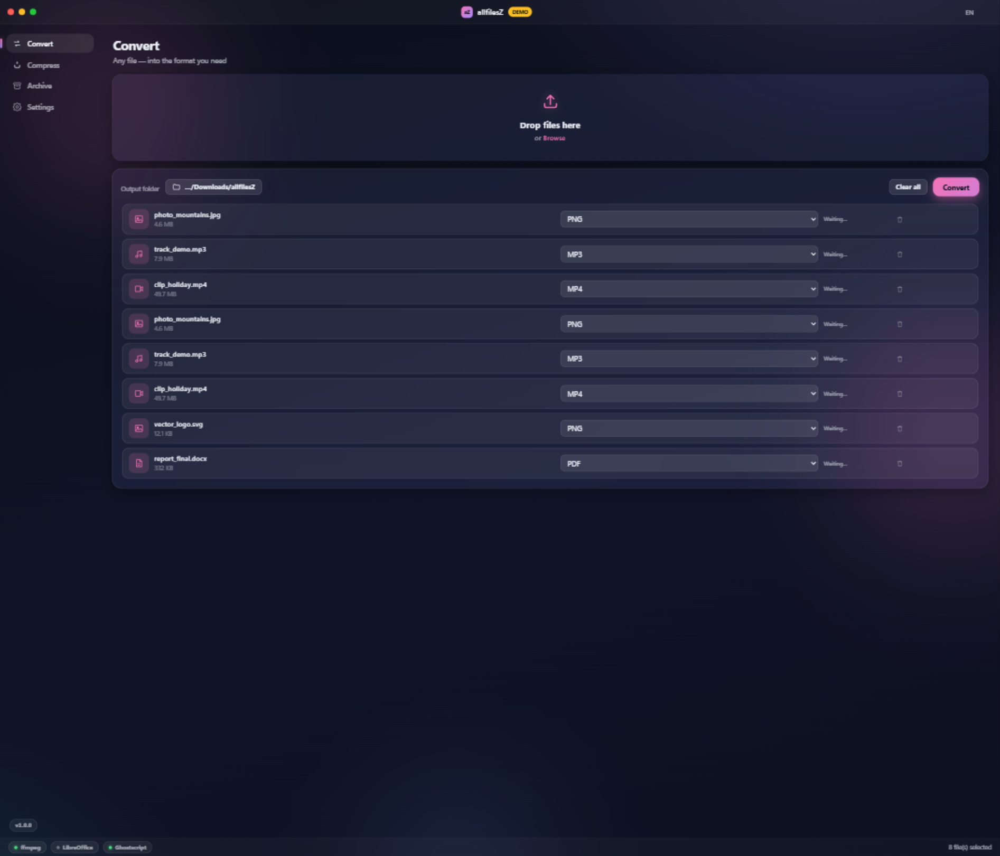
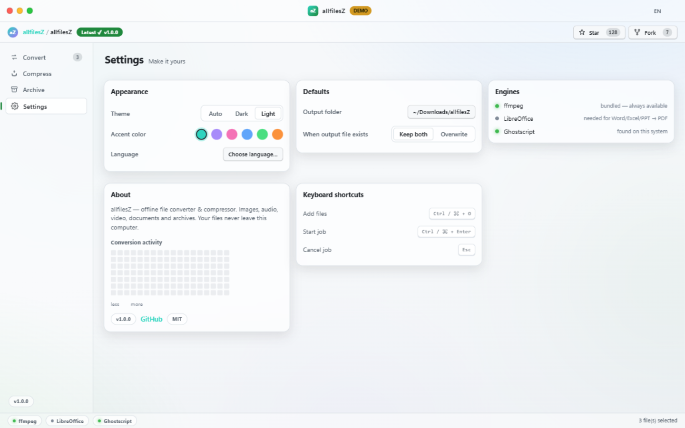

<div align="center">


# allfilesZ

**Convert & compress anything — beautifully.**

A cross-platform, fully offline file converter and compressor for **Windows**, **Linux** and **macOS**,
with a glassmorphism UI that blends **macOS elegance** with the **Hyprland** desktop aesthetic.

[](https://github.com/dinaxy148822822-create/allfilesZ/actions/workflows/release.yml)
[](https://github.com/dinaxy148822822-create/allfilesZ/actions/workflows/ci.yml)
[](LICENSE)
[](#downloads)

**22 languages** · **Dark / Light / Auto themes** · **X11 & native Wayland** · **100 % offline**

[Downloads](#downloads) · [Features](#features) · [Install](#installation) · [Build from source](#build-from-source) · [Русская версия](README.ru.md)



</div>

---

## Features

- 🎨 **macOS × Hyprland × GitHub UI** — frameless window with traffic lights, frosted-glass panels,
  animated gradient orbs, 6 accent colors, dark/light/auto themes. Native acrylic blur on
  Windows 11, vibrancy on macOS, native Wayland (X11 fallback) on Linux — KDE, GNOME, Hyprland, Sway friendly.
- 🌸 **Anime character themes** — Hatsune Miku, Kasane Teto, Akita Neru, Megurine Luka,
  Kagamine Rin, GUMI; plus **your own background** (photo or animated GIF).
- 🖼 **Convert images** — PNG · JPG · WebP · AVIF · TIFF · GIF · ICO · PDF *(sharp/libvips, HEIC/BMP/SVG input)*
- 🎵 **Convert audio** — MP3 · WAV · OGG · OPUS · FLAC · M4A · AAC · WMA *(bundled ffmpeg — 20+ input formats)*
- 🎬 **Convert video** — MP4 · MKV · WebM · AVI · MOV · animated GIF *(H.264, VP9, per-file progress)*
- 📄 **Documents → PDF** — Word / Excel / PowerPoint / ODF / RTF / TXT *(via LibreOffice, auto-detected if installed)*
- 🗜 **Compress without visible loss** — quality-aware re-encoding with three presets
  (High / Balanced / Tiny) or custom sliders. If a file is already optimal, the original is kept untouched.
- 📚 **PDF tools** — merge PDFs, images → PDF. PDF compression when Ghostscript is available.
- 🗄 **Archives** — ZIP / TAR / TAR.GZ with store→max levels.
- 🌍 **22 languages** with instant switching and full RTL support (العربية, עברית).
- 🔒 **100 % offline** — no telemetry, no cloud, your files never leave the machine.
- ⌨️ Keyboard-first: `Ctrl/⌘+O` add · `Ctrl/⌘+Enter` start · `Esc` cancel · `Ctrl/⌘+,` settings.

### Compression quality reference (Balanced preset)

| Type | Method | Typical saving |
| --- | --- | --- |
| Photos (JPG) | MozJPEG q82 | 40–70 % smaller, visually identical |
| Screenshots/UI (PNG) | palette + max zlib | 30–60 % smaller |
| Video (H.264) | CRF 23 | 30–60 % smaller at same look |
| WAV audio | → FLAC (lossless) | 40–60 % smaller, bit-exact audio |
| MP3/M4A | re-encode 192 kbps | 20–50 % smaller |
| PDF | Ghostscript /ebook | 30–70 % smaller |

## Downloads

Grab an installer from **[Releases](https://github.com/dinaxy148822822-create/allfilesZ/releases/latest)**:

| OS | Package |
| --- | --- |
| Windows | `allfilesZ-x.y.z-setup-x64.exe` (installer) · `allfilesZ-x.y.z-portable-x64.exe` (portable) · arm64 installer |
| Linux | `.AppImage` (x64/arm64) · `.deb` · `.rpm` |
| macOS | `.dmg` for Apple Silicon and Intel |

## Installation

<details open>
<summary><b>Windows</b></summary>

```powershell
# installer (PowerShell)
irm https://raw.githubusercontent.com/dinaxy148822822-create/allfilesZ/main/scripts/install.ps1 | iex

# or winget, once the manifest lands in winget-pkgs
winget install dinaxy.allfilesZ
```
Or download the `.exe` from [Releases](https://github.com/dinaxy148822822-create/allfilesZ/releases/latest) and run it.
</details>

<details>
<summary><b>Linux</b></summary>

```bash
# AppImage (any distro)
curl -fsSL https://raw.githubusercontent.com/dinaxy148822822-create/allfilesZ/main/scripts/install.sh | bash

# Debian / Ubuntu
sudo apt install ./allfilesZ_x.y.z_amd64.deb

# Fedora / RHEL
sudo dnf install ./allfilesZ-x.y.z.x86_64.rpm

# Arch (AUR)
yay -S allfilesz-bin

# snap: build manually with scripts/packaging/snapcraft.yaml
# snap: build manually with scripts/packaging/snapcraft.yaml (Snap Store submission pending)
```
Optional system engines: `sudo apt install ghostscript libreoffice` unlock PDF compression and document→PDF.
A flatpak manifest is included in [`scripts/packaging/`](scripts/packaging/) for Flathub submission.
</details>

<details>
<summary><b>macOS</b></summary>

Download the `.dmg`, drag **allfilesZ** to *Applications*.
The app is unsigned (ad-hoc) — on first launch right-click → **Open**, or:
```bash
xattr -d com.apple.quarantine /Applications/allfilesZ.app
```
</details>

## Build from source

```bash
git clone https://github.com/dinaxy148822822-create/allfilesZ
cd allfilesZ
npm ci
npm start          # run in dev
npm test           # engine tests (sharp + ffmpeg, all formats)
npm run dist       # package for the current OS (see electron-builder.yml)
```

Releasing: push a `v*` tag — [release.yml](.github/workflows/release.yml) builds Windows, Linux
and macOS artifacts on CI and attaches them to a GitHub release automatically.

## Languages

English · Русский · Українська · Deutsch · Français · Español · Português · Italiano · Nederlands ·
Polski · Čeština · Svenska · Türkçe · العربية (RTL) · עברית (RTL) · हिन्दी · Bahasa Indonesia ·
Tiếng Việt · 简体中文 · 繁體中文 · 日本語 · 한국어

Auto-detected from the system locale; switch anytime from the globe menu. Missing yours?
Add one JSON file in [`src/renderer/i18n/`](src/renderer/i18n/) — see [CONTRIBUTING.md](CONTRIBUTING.md).

## Tech

Electron · sharp (libvips) · bundled static ffmpeg · pdf-lib · archiver.
The renderer runs with `contextIsolation` on and no node integration; all file operations go
through a typed IPC bridge in the main process.

## License

[MIT](LICENSE) © allfilesZ contributors

<div align="center"></div>
