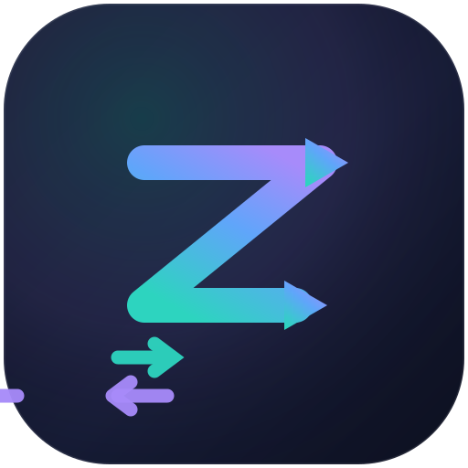
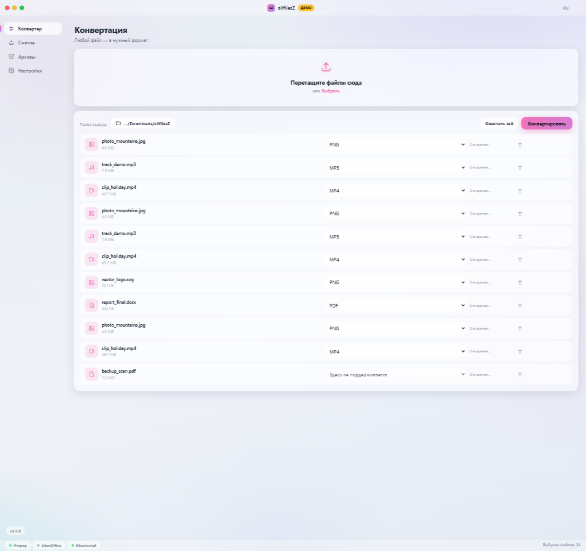

<div align="center">



# allfilesZ

**Конвертируйте и сжимайте что угодно — красиво.**

Кроссплатформенный офлайн-конвертер и компрессор файлов для **Windows**, **Linux** и **macOS**
с интерфейсом в стиле «стекло», соединяющим элегантность **macOS** и эстетику **Hyprland**.

[](https://github.com/dinaxy148822822-create/allfilesZ/actions/workflows/release.yml)
[](https://github.com/dinaxy148822822-create/allfilesZ/actions/workflows/ci.yml)
[](LICENSE)

**22 языка** · **Тёмная / светлая / авто тема** · **X11 и нативный Wayland** · **100 % офлайн**

[Скачать](#установка) · [Возможности](#возможности) · [English version](README.md)



</div>

---

## Возможности

- 🎨 **Интерфейс macOS × Hyprland** — окно без рамки с «светофором», стеклянные панели с блюром,
  анимированные градиентные орбы, 6 акцентных цветов, тёмная/светлая тема. Нативный acrylic-блюр
  в Windows 11, vibrancy на macOS, нативный Wayland (и X11) на Linux — дружелюбно к KDE, GNOME, Hyprland, Sway.
- 🖼 **Конвертация изображений** — PNG · JPG · WebP · AVIF · TIFF · GIF · ICO · PDF
  *(sharp/libvips; на входе также HEIC, BMP, SVG)*
- 🎵 **Конвертация аудио** — MP3 · WAV · OGG · OPUS · FLAC · M4A · AAC · WMA
  *(встроенный ffmpeg — более 20 входных форматов)*
- 🎬 **Конвертация видео** — MP4 · MKV · WebM · AVI · MOV · анимированный GIF
  *(H.264, VP9, прогресс по каждому файлу)*
- 📄 **Документы → PDF** — Word / Excel / PowerPoint / ODF / RTF / TXT
  *(через LibreOffice — определяется автоматически, если установлен)*
- 🗜 **Сжатие без заметных потерь** — умное перекодирование с тремя пресетами
  (Высокое / Баланс / Минимум) или ручными слайдерами. Если файл уже сжат оптимально — оригинал не трогаем.
- 📚 **Инструменты PDF** — объединение PDF, изображения → PDF. Сжатие PDF при наличии Ghostscript.
- 🗄 **Архивы** — ZIP / TAR / TAR.GZ со степенями от «без сжатия» до максимальной.
- 🌍 **22 языка** с мгновенным переключением и полной поддержкой RTL (العربية, עברית).
- 🔒 **100 % офлайн** — никакой телеметрии и облака: файлы не покидают компьютер.
- ⌨️ Горячие клавиши: `Ctrl+O` добавить · `Ctrl+Enter` старт · `Esc` отмена · `Ctrl+,` настройки.

### Сколько экономит сжатие (пресет «Баланс»)

| Тип | Метод | Типичная экономия |
| --- | --- | --- |
| Фото (JPG) | MozJPEG q82 | −40–70 %, визуально без отличий |
| Скриншоты/UI (PNG) | палитра + zlib 9 | −30–60 % |
| Видео (H.264) | CRF 23 | −30–60 % при том же виде |
| Аудио WAV | → FLAC (без потерь) | −40–60 %, звук бит-в-бит |
| MP3/M4A | перекодирование 192 kbps | −20–50 % |
| PDF | Ghostscript /ebook | −30–70 % |

## Установка

Готовые сборки — на странице **[Releases](https://github.com/dinaxy148822822-create/allfilesZ/releases/latest)**:

| ОС | Формат |
| --- | --- |
| Windows | `allfilesZ-x.y.z-setup-x64.exe` (инсталлятор) · `allfilesZ-x.y.z-portable-x64.exe` (портативная) · arm64 |
| Linux | `.AppImage` (x64/arm64) · `.deb` · `.rpm` · snap |
| macOS | `.dmg` для Apple Silicon и Intel |

<details open>
<summary><b>Linux — одной командой</b></summary>

```bash
curl -fsSL https://raw.githubusercontent.com/dinaxy148822822-create/allfilesZ/main/scripts/install.sh | bash
```
Необязательные движки: `sudo apt install ghostscript libreoffice` — включат сжатие PDF и конвертацию документов.
Для Arch в репозитории есть `PKGBUILD` (AUR `allfilesz-bin`), для Flathub — flatpak-манифест в `scripts/packaging/`.
</details>

<details>
<summary><b>Windows — одной командой</b></summary>

```powershell
irm https://raw.githubusercontent.com/dinaxy148822822-create/allfilesZ/main/scripts/install.ps1 | iex
```
</details>

<details>
<summary><b>macOS</b></summary>

Скачайте `.dmg` и перетащите **allfilesZ** в «Программы». Приложение не подписано (ad-hoc):
при первом запуске ПКМ → «Открыть» или выполните
`xattr -d com.apple.quarantine /Applications/allfilesZ.app`.
</details>

## Сборка из исходников

```bash
git clone https://github.com/dinaxy148822822-create/allfilesZ
cd allfilesZ
npm ci
npm start        # запуск в dev-режиме
npm test         # тесты движков (sharp + ffmpeg, все форматы)
npm run dist     # сборка пакета для текущей ОС
```

Релизы: пуш тега `v*` — [release.yml](.github/workflows/release.yml) сам соберёт артефакты
для Windows, Linux и macOS и приложит их к релизу на GitHub.

## Технологии

Electron · sharp (libvips) · встроенный статический ffmpeg · pdf-lib · archiver.
Рендерер работает с `contextIsolation` без node-интеграции; все операции с файлами идут
через типизированный IPC-мост в main-процессе.

## Лицензия

[MIT](LICENSE) © участники allfilesZ
